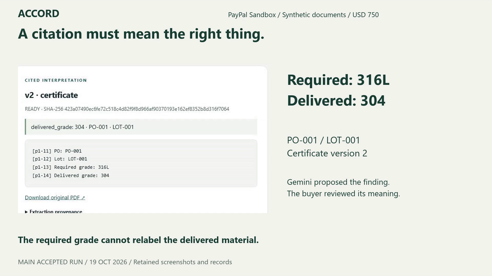
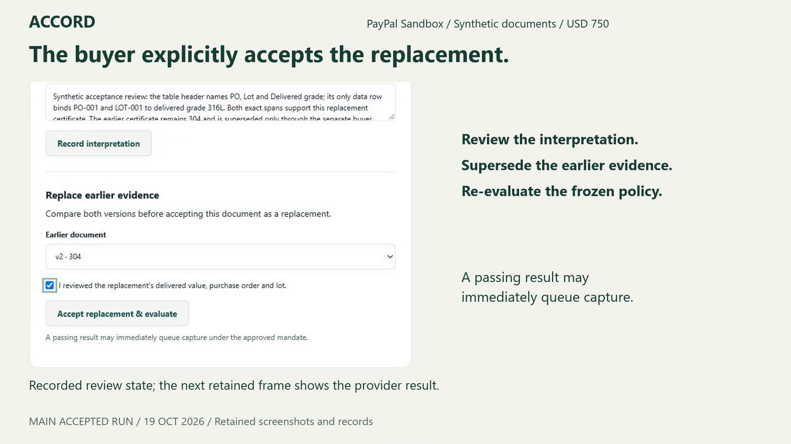
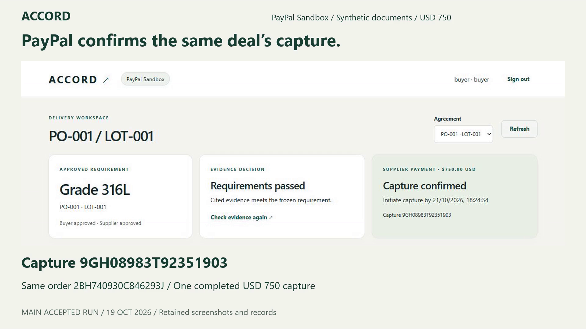
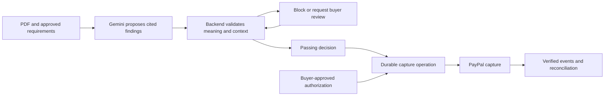

# ACCORD

**Delivery evidence before PayPal capture.**

ACCORD uses AI to check delivery paperwork against approved requirements before a supplier captures a PayPal payment.

A manufacturer orders grade **316L** steel. The delivery certificate says **304**. ACCORD shows the exact passage and blocks capture. A corrected certificate needs explicit buyer review before it can satisfy the agreed payment conditions.

[Hosted interface](https://accord-api-fyux.onrender.com/) · [Run the verification suite](#run-the-verification-suite) · [Interactive setup](#run-an-interactive-sandbox-demo) · [MIT license](LICENSE)



*Retained evidence from the accepted PayPal Sandbox run, using synthetic documents. These screenshots show recorded states, not a new live transaction.*

## How it works

1. **Agree on the requirement.** The buyer and supplier approve the same purchase order, lot, material grade and conditional-capture mandate. The supplier is the PayPal merchant.
2. **Authorize the payment.** The buyer approves one **USD 750 Sandbox authorization** through PayPal.
3. **Inspect the evidence.** The supplier uploads a certificate; the buyer provides a receipt and acknowledges delivery. Gemini proposes findings with exact source passages.
4. **Check meaning and context.** The backend checks the document version, field meaning, purchase order and lot against the frozen policy. Missing, conflicting or inadmissible evidence requires review. Delivered 304 cannot be relabeled as 316L.
5. **Review a replacement.** Uploading another PDF alone does not resolve competing evidence. The buyer must inspect and explicitly accept the corrected replacement.
6. **Capture and confirm.** Passing evidence permits the single capture operation. PayPal confirms the financial outcome separately. An uncertain outcome displays **Reconciling** until it is established.

<details>
<summary><strong>See the reviewed replacement and confirmed capture</strong></summary>

The buyer records the interpretation and explicitly accepts the replacement:



The same deal then records one completed PayPal capture:



</details>

## Why the evidence trail matters

A document can contain both **“required grade: 316L”** and **“delivered grade: 304.”** Extracting the desired number is insufficient. ACCORD connects a cited interpretation, buyer review and an agreed rule to a specific payment operation.

**AI proposes the finding. The backend enforces the conditions. The model has no payment authority.**

The MVP supports one buyer, one supplier merchant, one authorization and one final capture per deal. Capture must be initiated within **48 hours of PayPal's authorization creation timestamp**; pending settlement can resolve later. ACCORD checks documentary evidence. It does not establish that a certificate is truthful or that physical goods match it.

## Recorded acceptance

The Sandbox MVP was independently accepted on **26 October 2026** at commit [`0ccc74c`](https://github.com/Anvay-Sanil/ACCORD/tree/0ccc74cf65a25f66a76eb071dae86a3c80c38be2).

| Check | Recorded result |
| --- | --- |
| PostgreSQL regression suite | **95 tests passed** on real PostgreSQL |
| Browser journey | **8 assertions passed**, using explicit payment/model doubles |
| Linux execution | Startup, migrations, parser limits, process recovery and browser checks passed at the accepted commit; [CI run](https://github.com/Anvay-Sanil/ACCORD/actions/runs/39186060795) |
| Real model extraction | **10 recorded Gemini cases** checked against their PDFs, citations and admission rules |
| Real PayPal Sandbox | **Two completed captures**, with authenticated event verification; one main deal and one separate recovery deal |
| Duplicate submission | Two sequential and four concurrent submissions reused the main deal's capture operation |
| Uncertain-response recovery | A successful capture response was deliberately dropped; recovery preserved the operation, request key and payload and made **zero additional capture POSTs** |

The main run and controlled recovery test are separate evidence scopes. The main run's original report retains its `INCOMPLETE` status because its missing uncertain-response proof is supplied by the separate accepted recovery run. Regression/Linux providers are doubles; real-provider evidence was checked separately. The ten model cases are one recorded sample, not a general accuracy guarantee.

These are recorded acceptance results. Current hosted uptime, unrestricted judge access and production readiness are outside that acceptance. The completed narrated walkthrough is **2:58**; its YouTube link has not yet been added to this repository.

## Try the interface

Open the [hosted interface](https://accord-api-fyux.onrender.com/). It requires provisioned buyer/supplier application accounts. The hosted URL is an inspection entry point; a self-service judge account or fresh ready-to-pay deal is not included.

For a reproducible run without external credentials, use the verification stack below. For an interactive journey with real Sandbox services, follow the separate setup route.

## Run the verification suite

Requires Git, Docker with a **Linux engine**, and Docker Compose. No PayPal or model API credentials are needed.

```sh
git clone https://github.com/Anvay-Sanil/ACCORD.git
cd ACCORD
docker compose --project-name accord-acceptance -f compose.acceptance.yaml up --build --abort-on-container-exit --exit-code-from acceptance
```

A successful run exits with code **0** and writes execution records to `acceptance-record/linux/`. It runs the real application, PostgreSQL, PDF parser and browser against explicit PayPal/model doubles. The stack exits after verification; it does not leave an interactive demo running or make real payments.

The same workflow is available under [GitHub Actions](https://github.com/Anvay-Sanil/ACCORD/actions/workflows/accord-linux-acceptance.yml). Detailed checks live in [`acceptance/`](acceptance/) and [`tests/`](tests/).

## Run an interactive Sandbox demo

Use Python **3.12** and PostgreSQL **17**, or the application services in [`compose.yaml`](compose.yaml).

1. Copy [`.env.example`](.env.example) to a private `.env` and replace the placeholders. Set `EXTRACTION_PROVIDER=gemini` and configure your Gemini key/model; the example defaults to the alternative OpenAI adapter. See [Gemini setup](GEMINI_SETUP.md).
2. Configure the supplier's PayPal Sandbox application, merchant ID, registered webhook ID and buyer payer ID. Register `APP_ORIGIN/api/webhooks/paypal` as the webhook endpoint on your reachable HTTPS origin.
3. Provision the database, apply migrations and create separate buyer/supplier application accounts. Use the [detailed provisioning commands](IMPLEMENTATION_NOTES.md#local-setup) and [journey setup](JOURNEY.md#configuration-and-startup). Keep schema-owner credentials confined to provisioning tools.
4. Start the API **and both workers**: `accord.worker` for payments and `accord.extraction_worker` for documents. The corresponding Compose services are `api`, `payments` and `extraction`.
5. Generate synthetic PDFs with `python -m acceptance.fixtures --output acceptance/fixtures`, then follow the [buyer/supplier browser sequence](JOURNEY.md#browser-sequence).

Public deployment requires HTTPS, `PUBLIC_DEPLOYMENT=true` and `SESSION_SECURE=true`. Local HTTP exceptions apply only to loopback development. Keep `FAULT_DROP_CAPTURE_RESPONSE=false` in public deployments. Keys, application passwords and `.env` files must remain private.

Tests reset their disposable test schema: use the isolated acceptance stack or a dedicated `accord_test` database, not a database containing working deals. Additional deployment instructions are in [Render setup](RENDER_JOURNEY_UPDATE.md).

## Architecture



| Component | Implementation |
| --- | --- |
| Buyer/supplier interface | HTML, CSS and JavaScript served by FastAPI; no frontend build step |
| Backend and validation | Python, FastAPI and Pydantic |
| Durable state | PostgreSQL: frozen policy, document versions, reviews, operations, dispatch journal and webhook inbox |
| Extraction | Constrained PDF parsing, Gemini adapter and a separate extraction worker |
| Payments | PayPal Sandbox API, persisted request identities, concurrency guards, deadline checks and a separate payment worker |
| Verification | pytest, Playwright, Docker Compose and GitHub Actions |

## Engineering documentation

- [Detailed implementation and operation contracts](IMPLEMENTATION_NOTES.md)
- [Buyer/supplier journey and acceptance commands](JOURNEY.md)
- [Gemini adapter and recorded extraction scope](GEMINI_SETUP.md)
- [Deployment configuration](RENDER_JOURNEY_UPDATE.md)

The detailed engineering documents preserve earlier checkpoint reports. Their historical phase labels describe those checkpoints; the recorded acceptance summary above reflects the later accepted Sandbox MVP. No customer adoption, time-saving or dispute-reduction claim has been measured.

## License

[MIT](LICENSE).
